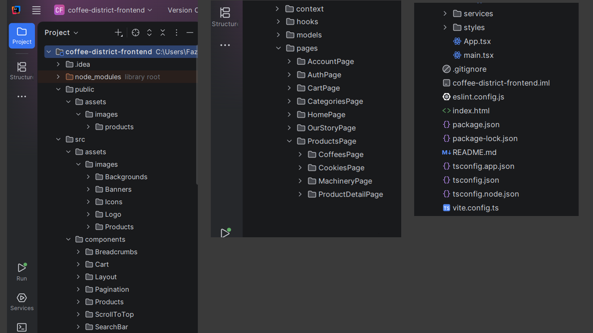

# coffee-district-frontend
Coffee District is a full-stack e-commerce application for exploring coffee, cookies and brewing equipment, with the ability to browse products and manage a shopping cart.  
The application is an independent portfolio project developed as part of my practical learning journey in full-stack development.   
This repository contains a selected public version of the frontend, showcasing the application's main features, component-based architecture and user-facing experience.   
The frontend was developed using React and TypeScript, with a Spring Boot backend providing server-side functionality.  
Additional development materials, testing resources, design assets and documentation can be presented and discussed during the interview process.  
 
🎥 **Website Walkthrough:** [Watch the Coffee District demo on Vimeo]( https://vimeo.com/1247966695/970fde48ab?fl=ip&fe=ec)
   
🔗 **Backend Repository:** [Coffee District Backend](https://github.com/fazilak-a/coffee-district-backend)  

 

## Technologies
- React, TypeScript and Vite
- CSS3
- React Router
- React Hook Form
- React Context API 
- Axios
- Session-based Authentication

 

## Main Features
•	**Product Catalogue:** Product browsing by category, search and pagination  
•	**Product Details:** Individual product pages for coffee, cookies and brewing equipment 
•	**Shopping Cart:** Add and remove products, adjust quantities and calculate totals, with localStorage persistence 
•	**Authentication:** User registration, login and session-based authentication 
•	**Navigation:** Shared layout, responsive breadcrumb navigation and client-side routing with React Router 
•	**User Interface:** Custom CSS styling, animations and interactive elements 

 

## Project Structure
The frontend follows a component-based architecture, with a clear separation of components, pages, context, models, hooks, services and application assets.   
The structure below highlights the main directories and files included in this public repository.  

  

 

## Running the Application
Prerequisites: Node.js and np 
The frontend runs locally using Vite. The backend and database must also be configured and running for full application functionality.  
1.	Clone the repository
2.	Navigate to the project directory
3.	Install dependencies: npm install
4.	Start the development server: npm run dev

 

## Project Status
**In progress:** Wishlist functionality, account/profile functionality and responsive refinements.  
**Future improvements:** Admin area, frontend filtering and sorting interface, and automated tests.  
**Scope limitation:** No payment gateway or online payment processing is included.  

